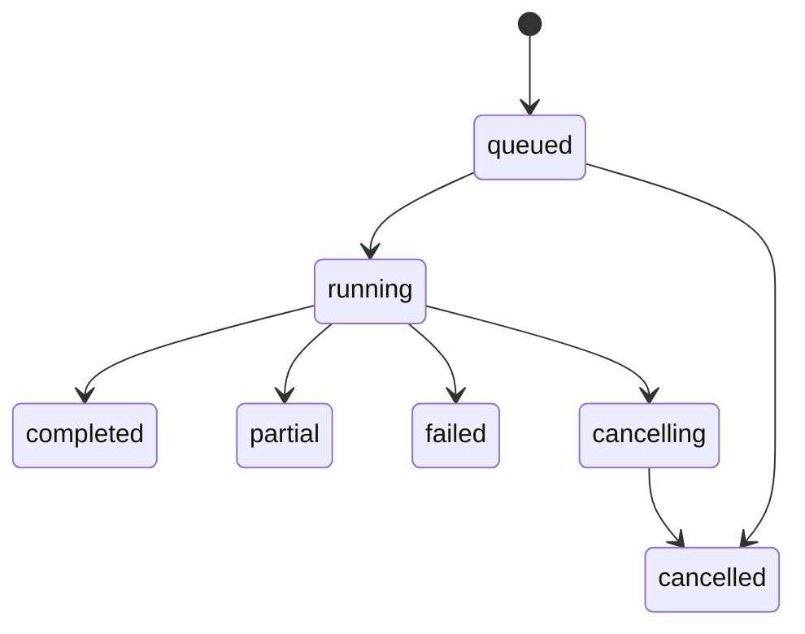

# HTTP API設計 v1

2026-10-10 / 設計段階。実装言語Go。契約は [OpenAPI](../api/openapi.json)。

## 方針

NVD・AIの応答時間に依存するため、単一パッケージもSBOMも非同期ジョブで統一する。JSON/HTTPS、ベースパス `/v1`。アプリ用Bearerトークンで認証し、AI各社のキーはサーバー設定にのみ保持する。初期版は単一組織運用だが、ジョブは認証主体 `owner_id` に所属し、他主体のジョブは404とする。辞書は認証利用者間で共有する。

公開APIのproviderは `openai | gemini | claude | deepseek`。許可されたモデルIDのみ受付。MVPは一実行一モデルとし、比較は同一入力を各providerで別ジョブとして実行する。自動の別社フォールバックは初期APIに含めない。

## エンドポイント

| Method | Path | 成功 | 用途 |
|---|---|---|---|
| GET | /v1/providers | 200 | サーバーで利用可能なプロバイダー・許可モデル |
| POST | /v1/package-searches | 202 | 名前・ベンダーを直接指定してCPE/PURL検索ジョブ作成 |
| POST | /v1/resolutions | 202 | パッケージ配列またはSBOMからジョブ作成 |
| GET | /v1/resolutions/{job_id} | 200 | 状態・件数・実効設定・期限 |
| POST | /v1/resolutions/{job_id}/cancel | 202 | キャンセル要求。終端状態は200で現状態 |
| GET | /v1/resolutions/{job_id}/results | 200 | 終端ジョブのコンポーネント結果をページ取得 |
| GET | /v1/cpes | 200 | ローカルNVD CPE辞書検索 |
| GET | /v1/purls | 200 | OSV由来の記録があるローカルPURL検索 |
| POST | /v1/search/{kind} | 200 | 実験用。ローカル辞書の名前をtrigram/編集距離で検索 |

`POST /v1/search/cpes` と `/v1/search/purls` は [類似検索API試作](../cmd/fuzzy-search-api/main.go) 用の同期エンドポイント。起動時に指定したJSON辞書をメモリへロードする。`query`を必須、`vendor`/`ecosystem`を任意指定し、最大100件を返す。結果は名称類似の候補であり、CPE/PURL同一性や外部確認を保証しない。この試作は現行サービス層・PostgreSQL辞書のAPI実装ではなく、評価用に分離する。OpenAPI契約は暫定で、既存辞書APIへの統合時に再設計する。

辞書検索は保存済みデータだけを読み、AI呼出や外部同期を起動しない。`/purls`にAI生成だけの候補を混ぜない。辞書検索の空結果は「ローカルに記録なし」であり、全世界の不存在を意味しない。CVE一覧や脆弱性スキャンAPIは今回の範囲外。

## 名前・ベンダーからの検索

SBOMを用意せず `POST /v1/package-searches` に名前・ベンダーを直接渡せる。

```json
{
  "name": "log4j-core",
  "vendor": "Apache Software Foundation",
  "options": {
    "provider": "openai",
    "model": "SERVER_ALLOWED_MODEL_ID"
  }
}
```

nameとvendorは必須で、空白のみは422。version、ecosystem、namespace、repository_urls、existing_cpes、existing_purlsは任意。バージョンがなくても検索でき、未確認バージョンを補完しない。targets省略時はCPEとPURLの両方を検索する。入力ID・SBOM・パッケージ配列は不要。

AIによる別名・候補生成とNVD/OSV照合を行う。PURLではベンダーをnamespaceに直接変換しない。名前とベンダーだけで曖昧な場合は候補とreview_requiredを返す。

202で通常のJobを返し、Locationで示す `/v1/resolutions/{job_id}` をポーリングする。終端状態になったら `/v1/resolutions/{job_id}/results` でCPE/PURL候補と根拠を取得する。キャンセルも既存のresolutions APIを利用する。

内部では `input.kind=packages`、1件のパッケージ（id=`component-1`）に変換し、既存のジョブ処理を共有する。DBのinput_kindはpackages、source_pointerは空文字（入力JSONのルート）とする。input_documentには受信した検索リクエストを保存し、run_metadata.entrypointにpackage_searchを記録する。追加テーブルは不要。

冪等キーの名前空間は2つの作成エンドポイントで共有するが、リクエストハッシュにはエンドポイントも含める。同じキーを別エンドポイントで再利用した場合は409とする。エラーのpointerは受信した検索JSONに対応し、名前の不正なら `/name` を返す。

## SBOM・パッケージ配列の作成リクエスト

```json
{
  "input": {
    "kind": "packages",
    "packages": [{
      "id": "component-1",
      "name": "log4j-core",
      "vendor": "Apache Software Foundation",
      "version": "2.17.1",
      "ecosystem": "Maven",
      "namespace": "org.apache.logging.log4j"
    }]
  },
  "options": {
    "provider": "openai",
    "model": "SERVER_ALLOWED_MODEL_ID",
    "targets": ["cpe", "purl"],
    "max_candidates": 5
  }
}
```

`input`はdiscriminator付きoneOf。`kind=sbom`なら`format=cyclonedx|spdx`と`document`にSBOM JSONオブジェクトを渡す。ファイルURLやmultipart受付は初期版に含めない。SBOMスキーマと対応版は受理前に検証する。HTTP JSON全体は最大10 MiB、展開後コンポーネントは最大1,000件、深さは最大64。これらは初期運用値として設定可能で、緩和時にも上限を維持する。

packagesのidはリクエスト内で一意。SBOMの重複参照IDは422、参照ID欠損時は元JSON Pointerから安定IDを生成する。名前は空白のみも拒否。vendor省略は処理を継続し、注意理由を残す。対応外ecosystemは入力拒否せずPURL側をunsupportedとする。既存CPE/PURL文字列の構文不正は422。

202応答はJobを返し、`Location`に状態URL、`Retry-After: 2`を付ける。DBへの入力・ジョブ保存とキュー投入用状態を一トランザクションで確定してから返す。

## 冪等性と再試行

POST作成には任意の `Idempotency-Key`（1～128文字）を受付。認証主体+キーで24時間保持し、同じキー・同じ意味のリクエストは元のジョブを202で返す。エンドポイントとリクエストをハッシュ対象とする。JSONオブジェクトのキー順は無視し、配列順は保持した正規化JSONのSHA-256で比較する。異なる入力/optionなら409。デフォルト適用前のリクエストをハッシュ化し、再送時には元の実効設定を維持する。キーなしの再送は新規ジョブになる。

既存ジョブの再実行・再解析は新しいキーで新規作成する。終端結果は変更しない。

## 状態遷移



- completed：全対象の処理が技術的に完了。要確認・未解決があってもよい。
- partial：一部の外部障害や予算打ち切りがあるが、少なくとも一対象で利用可能な結果がある。
- failed：どの対象にも利用可能な結果がない技術的失敗、またはジョブ全体の致命的障害。
- cancelled：ユーザー要求により停止。確定済み結果は取得可能。

Job.progressはtotal/processed。processedは当該コンポーネントの全要求対象を評価し終えた件数で、エラー評価も含む。対象別の失敗はResult.errorsにも記録する。キャンセルと完了の競合はDBの条件付き更新を最初に確定した側を採用する。running以降のキャンセルは実行中の外部処理をbest effortで中断し、すでに発生したAPI費用は取り消せない。

## 結果・根拠

結果APIはqueued/running/cancellingには409 `RESULTS_NOT_READY`。終端状態では200、確定済み結果なしでも空配列を返す。`cursor`によるkeysetページング、limit既定100・最大200、順序は入力のordinal。cursorはジョブID・期限・末尾ordinalを含む署名付きopaque値とし、他ジョブへの流用・改ざんは400。

コンポーネント内にcpe/purlを別々に持ち、要求しなかったtargetは省略する。`decision`、`verification`、`identity`を独立に表現する。候補0件の場合もResultSet.lookupでno_evidence/error/unsupported等を残す。selected_candidate_idsは同じResultSet内の候補を参照する。

Evidenceは確認時のsource_record_id、問い合わせ条件、確認範囲、応答ハッシュ、観測時刻を保持する。現行辞書が更新されても過去結果は変わらない。OSVの記録一致はPURLの全要素・バージョンの実在保証ではない。OSV空結果から安全性は返さない。

Job.run_metadataはプロンプト・ルール・スキーマ版、入力ハッシュ、設定ハッシュとプロバイダー使用量を保存する。利用料金を取得できない場合は金額を捏造せず省略する。

## エラー仕様

共通JSONは `{ "error": { "code": "...", "message": "...", "request_id": "...", "details": [{"pointer":"/input/packages/0/name","message":"..."}] } }`。

| HTTP | code例 | 意味 |
|---|---|---|
| 400 | INVALID_JSON / INVALID_CURSOR | 構文不正・不正なページ指定 |
| 401 | UNAUTHENTICATED | トークン欠損・無効 |
| 403 | FORBIDDEN | 認証済みだが操作権限なし |
| 404 | NOT_FOUND | リソースなし・別主体所有・期限後削除済み |
| 409 | IDEMPOTENCY_CONFLICT / RESULTS_NOT_READY | 状態の競合 |
| 413 | PAYLOAD_TOO_LARGE | サイズ超過 |
| 415 | UNSUPPORTED_MEDIA_TYPE | application/json以外 |
| 422 | INVALID_INPUT / MODEL_NOT_ALLOWED | スキーマ・業務バリデーション不正 |
| 429 | RATE_LIMITED | 利用者の同時ジョブ・受付制限。Retry-Afterあり |
| 503 | SERVICE_UNAVAILABLE | DB/ワーカー停止等で受理できない |
| 500 | INTERNAL_ERROR | 想定外エラー |

受理後のNVD/OSV/AI障害はジョブと対象別errorsに表現し、状態取得を502にはしない。API認証401と、外部プロバイダーの認証失敗を混同しない。外部レスポンスやAPIキーをエラー本文に含めない。

## Go実装境界

`internal/httpapi`でJSON/認証/上限/契約検証、`internal/service`でジョブ受付・照会、`internal/worker`で推論、`internal/store/postgres`で永続化。ハンドラー内でAI呼出を待たない。最初はGoのnet/httpとPostgreSQLのジョブテーブルで構成し、外部メッセージブローカーは必須にしない。

契約バージョンは `/v1`。既存フィールドの意味変更・削除・必須化は新API版で行う。入力の未知フィールドは拒否し、出力の追加フィールドはクライアントで許容する。

仕様参照：[OpenAPI 3.0.3](https://spec.openapis.org/oas/v3.0.3)。これは採用版であり、最新版という意味ではない。
