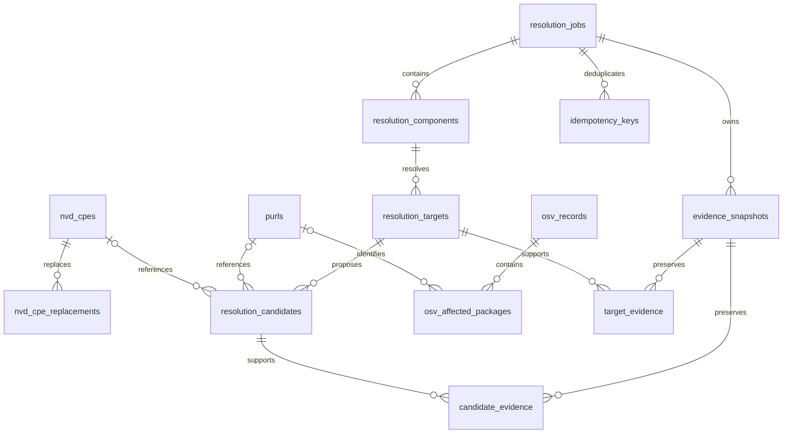

# DB設計

2026-10-10 / PostgreSQLを初期案として採用。DDLは [db/schema.sql](../db/schema.sql)。既存DBへの適用は未実施。

## 保存対象と境界

「NVDを保存」は初期版ではNVDのCPE辞書を指す。CVE全件・CPE Match Criteria全件の保存は対象外。PURLには単一の中央登録簿がないため、仕様上の識別子とOSVのパッケージ記録を別テーブルにする。OSVは根拠に使ったレコードのみ取得・保存する。最初はオンデマンド取得、NVDの全件初期同期・差分同期は運用オプションとする。

DB内のデータは次の3層に分ける。

1. 最新辞書：NVD CPE、PURL、OSVレコードとaffected package。
2. 作業データ：入力、ジョブ、コンポーネント、対象別判定、候補。
3. 監査用根拠：照会条件・取得時刻・ハッシュ・当時の応答内容。

CPE→PURLの直接マッピング表は作らない。同じコンポーネントに紐付いた候補として関係を表現し、製品の識別子とエコシステム内の識別子を混同しない。

## 関係

## テーブル責務

| テーブル | キー・役割 |
|---|---|
| nvd_cpes | NVDのcpeNameId(UUID)がPK。CPE文字列、構成要素、非推奨状態、原文、更新時刻 |
| nvd_cpe_replacements | 元UUIDと置換UUIDの組。未取得の置換先も保存可能 |
| purls | 内部UUID、正規化済み完全PURLとSHA-256、構成要素、正規化規則版 |
| osv_records | OSV IDがPK。modified、withdrawn、原文 |
| osv_affected_packages | OSV ID+affected配列位置。ecosystem/name、明示または導出PURL、影響範囲の原文 |
| resolution_jobs | UUID、認証主体、状態、実効設定、入力、版情報、使用量、lease、保存期限 |
| idempotency_keys | 認証主体+キーがPK。入力ハッシュとジョブ、24時間の期限 |
| resolution_components | job+component IDがPK。元位置、原文、共通モデル、処理状態 |
| resolution_targets | job+component+targetがPK。候補なしの場合も判定・照会状態を保存 |
| resolution_candidates | UUID。順位・候補値・確認・適合・採用。対応する辞書IDは任意 |
| evidence_snapshots | UUID。ジョブ所有の不変な根拠スナップショット |
| candidate_evidence / target_evidence | 同一ジョブ内の候補/対象と根拠を多対多で関連付け |
| source_sync_state | source+streamがPK。同期の期間、確定watermark、再開cursorとlease |

## 識別子の扱い

CPEはエスケープを理解するパーサーで分解する。`attributes`にupdate/edition/language/sw_edition/target_sw/target_hw/otherを保存し、`*`・`-`・空値を混同しない。検索文字列ではなくNVDが返した登録文字列を保存する。

PURLの同一性はtype/namespace/nameだけでなくversion/qualifiers/subpathを含む完全なcanonical PURLで決める。qualifiersの並び順は仕様に沿って正規化する。namespace/version/subpath不明はNULL、推測した値で埋めない。大文字小文字の扱いはtype別規則に従う。

長い文字列の一意インデックスを避けるため、完全な正規化文字列のSHA-256をUNIQUEにする。ハッシュ一致時にはアプリ側で文字列を必ず照合し、異なる場合は衝突エラーとして処理する。正規化規則変更時は既存行を黙って再解釈せず、重複統合・関連先更新を含む移行を行う。

OSV affectedにPURLがなければ対応エコシステムの規則から導出できるものだけ保存し、`purl_mapping=derived`とする。明示値はexplicit、未対応・不正値はunavailable。raw_purlとaffected原文を保持する。purlsに行があるだけでは確認済みとせず、`GET /v1/purls`は非withdrawnのOSVレコードに関連するもののみ返す。

入力由来・AI生成の未確認PURLはresolution_candidates.valueに保存し、共有辞書へ自動昇格させない。確認できた場合はpurl_idを関連付ける。CPEも同様に、未登録候補はnvd_cpesに作らない。

単体検索API `/v1/package-searches` も同じジョブ・コンポーネント表を使う。input_kindはpackages、入力原文は検索リクエスト、component_idはcomponent-1、source_pointerは空文字。run_metadata.entrypointで入口を識別する。追加テーブルは不要。

## 保存・同期の整合性

- NVDはUUIDでUPSERTし、古いsource_modified_atの応答で新しい行を上書きしない。deprecatedと置換先も同じトランザクションで更新する。
- OSVはIDとmodifiedで更新順序を確認し、affected子行を同一トランザクションで差し替える。withdrawnになった記録も削除せず保持する。
- NVD差分同期は固定した時間窓で全ページを取得し、完走後だけwatermarkを進める。公式の期間上限内で分割し、境界の重複区間を再取得してUPSERTする。
- 通信障害時は現行辞書を消さない。同期期間、cursor、leaseを保存して再開する。NVDのページ変動を踏まえ、再走査で取りこぼしを補正する。
- OSVは初期版では全体差分APIを仮定しない。既知IDの再取得とパッケージ照会のTTL更新を行う。
- 最新辞書のUPSERTと過去evidence_snapshotsの更新を連動させない。根拠は削除期限まで追記のみ。

## ワーカーとトランザクション

受付時にジョブ、全コンポーネント、冪等キーを一緒に保存する。ジョブテーブル自体がキューなので、別キューへの送信漏れは発生させない。

ワーカーは短いトランザクションでqueued行を `FOR UPDATE SKIP LOCKED` で取得し、running・lease_token・lease_untilを設定する。ネットワークI/O中はDBロックを保持しない。結果書き込みは現在のlease_token一致と有効期限を条件にし、期限切れワーカーの書き込みを拒否する。heartbeatで延長し、プロセス停止後は期限切れ行を再取得して未完了コンポーネントだけ再処理する。外部AI呼出のexactly-onceは保証せず、再実行で二重費用が起こり得ることを使用量に記録する。

コンポーネントのtargets/candidates/evidence関連とdoneへの変更は一トランザクションで確定する。processedはpending/running→done時だけ増やす。終端移行は同じジョブ行をロックして行い、cancellingとの競合を解消する。終端ジョブの結果は更新しない。

DB制約ではFK・一意性・状態値・採用時の確認済み条件を担保する。JSON内のスキーマ、CPE/PURL構文、targetとsourceの組、evidence_ids整合、候補の選択数、acceptedとselectedの整合はGoのサービス層で同一トランザクション内に検証する。正当な複数候補を表示しても自動採用は対象ごとに最大1件とする。

## 検索とAPIへの対応

- /cpes：vendor/productをB-treeで絞り込み、qはCPE文字列とタイトルの大文字小文字を区別しない部分一致。フィルター間はAND。qなしはUUID順一覧。大量データでは計測後にpg_trgm等を追加する。
- /purls：type/namespace/nameで絞り込み、qはcanonical_purl部分一致。OSV関連のEXISTS条件で絞る。複数記録は集約し一PURL一行にする。
- 辞書一覧はPKによるkeysetページング。検索条件と末尾PKをcursorに固定する。同期中の辞書検索はスナップショット保証なし、過去結果の取得は終端時点で不変。
- /resolutions/{id}/results：ownerを確認後、components.ordinalでページングし、targets、candidates、evidenceをバッチ取得する。候補ごとのN+1クエリを避ける。
- 全ジョブSQLにowner条件を要求し、別ユーザーのIDに対して404。共有辞書に社内SBOMの原文を混ぜない。DBの直接利用権限は運用者に限定する。

## 保持期間と運用

初期案は入力・ジョブ・結果・根拠30日、冪等キー24時間。レスポンスのexpires_atで期限を通知する。実行期限は最大1時間とし、期限切れ処理後にpartial/failedへ確定する。保存期限を迎えた終端ジョブを削除し、CASCADEで関連データを削除する。辞書は保持し、キャッシュと監査記録の保持期間を混同しない。

秘密鍵はDBに保存しない。入力・根拠を含むDBとバックアップはアクセス制限と暗号化を運用要件にする。通常ログには値を出さずjob_id/request_idを使う。バックアップと復元手順も実装段階で整備する。

DDLは新規空DB用の設計スナップショット。実装時は番号付きmigrationに変換し、既存列の変更はexpand/migrate/contractで実施する。JSONBは可変の外部原文・根拠に限定し、検索キー・状態・関連は型付き列にする。

検証予定：空DBでのDDL適用、ロールバック、FK違反、selected条件違反、同時冪等受付、lease失効後の旧ワーカー書き込み拒否、OSV更新後の過去根拠維持、owner越境拒否。

参照：[PostgreSQLの制約](https://www.postgresql.org/docs/current/ddl-constraints.html)。
