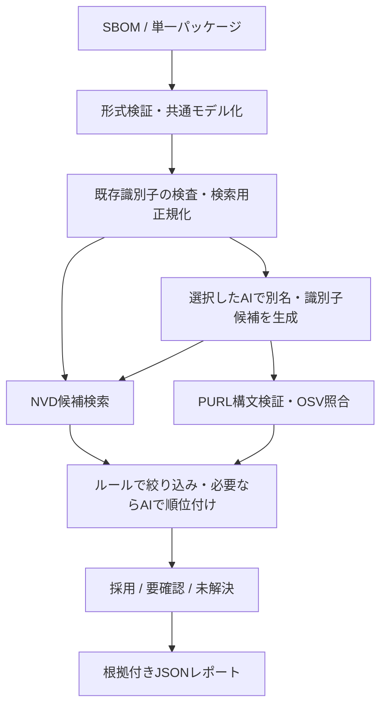

# SBOMからのCPE/PURL推論 基本設計

作成日：2026-10-10（JST） / 状態：初期設計案

## 1. 目的と初期スコープ

SBOMに含まれるパッケージ名・ベンダー名を起点にCPE 2.3とPURLを推論し、外部データとの照合結果、候補、根拠、未確定理由を返す。OpenAI、Google Gemini、Anthropic Claude、DeepSeekの4プロバイダーを交換可能にする。

基本設計に基づくGoのHTTP API基盤を実装済み。DBと実推論の接続は次段階とする。現在の実装範囲は[API実装](api-implementation.md)を参照。追加依頼によりHTTP APIとDBを初期設計に含める。詳細は[API設計](api-design.md)と[DB設計](database-design.md)を参照。実装言語はユーザー指定によりGoで確定する。入力形式・実行構成は以下を暫定採用する。

| 項目 | 初期案 |
|---|---|
| 言語 | Go（確定）。コア処理・外部APIクライアント・CLIをGoで実装 |
| 実行形態 | Go HTTP API + 非同期ワーカー + PostgreSQL。CLIも共通サービス層を使用 |
| SBOM入力 | CycloneDX 1.5/1.6 JSON、SPDX 2.3 JSON。対応外バージョンは明示エラー |
| 補助入力 | 単一パッケージの名前・ベンダー・任意のバージョン |
| 出力 | 元SBOMと独立したJSONレポート。元ファイルは変更しない |
| PURL対象 | npm、PyPI、Maven、Goから開始。対象外はunsupportedで返す |
| 対象外 | 初期段階のWeb UI、SBOMへの自動書き戻し、網羅的な脆弱性スキャン、全辞書のミラー |

名前は必須、ベンダー欠損は警告として処理する。バージョン、エコシステム、namespace/group、リポジトリURL、既存識別子があれば活用する。名前とベンダーだけで識別不能な入力に、無理に一つの回答を与えない。

## 2. 判定の原則

1. AIは候補と検索用の別名を提案する。外部確認状態をAIに決めさせない。
2. CPEはNVDが返した実在の文字列を保持し、生成した文字列を「登録済み」と扱わない。
3. PURLは仕様に沿って構築・解析し、OSVの該当パッケージ記録を根拠として保存する。
4. 辞書上の存在と、入力パッケージへの適合性は別軸とする。
5. CPEとPURLは独立に判定する。一方が未解決でも他方を返す。両者に一対一対応は仮定しない。
6. AIの自己申告確率や複数モデルの一致だけで自動採用しない。

OSVのAPIはパッケージに関する脆弱性照会用であり、汎用のPURL存在確認APIではない。[OSV Query API](https://google.github.io/osv.dev/post-v1-query/)
したがってOSVの一致記録は肯定的根拠に使えるが、記録なしは不存在を証明しない。完全な存在確認が必要な場合は、将来各パッケージレジストリの照合を追加する。

## 3. 全体構成



コアはparser、normalizer、resolver、decision、reportに分割する。外部I/OはNVDClient、OSVClient、AIProvider、Cacheのインターフェース越しに行い、テスト時に差し替える。

## 4. 入力の共通化

`Component`は次を保持する。

- `id`：文書内参照（bom-ref / SPDXID）。欠損時は入力位置から安定IDを作る。
- `name`, `version`, `group`, `ecosystem_hint`。
- `vendor_candidates[]`：値と出典フィールド、役割（supplier/manufacturer/originator等）。
- `existing_cpes[]`, `existing_purls[]`, `repository_urls[]`。
- `source_pointer`：元のJSON位置、`raw_values`：正規化前の値。

CycloneDXはネストしたcomponentsとmetadata.componentも走査し、supplier/manufacturer等は対応スキーマに存在するもののみ読む。SPDXはpackagesとexternalRefsを読む。supplierは販売・配布元の場合があるため、CPE vendorやPURL namespaceへの直接代入は禁止する。NOASSERTION等は欠損扱いとする。

表示用の原文は保存し、検索用に空白・大小文字・既知の法人表記を扱う。すべてのエコシステムに同じ小文字化規則を適用しない。バージョンの接頭辞やディストリビューションの改変版番号も無条件には除去しない。同名でもバージョン・エコシステム・配布元が異なるコンポーネントは統合しない。

## 5. CPEの推論とNVD確認

1. 既存CPEがあれば専用パーサーで検証してNVDと照合する。
2. 入力名・ベンダー、およびAIが提案した別名を使い、NVD CPE APIで候補を検索する。
3. `keywordSearch`による探索後、候補に基づく`cpeMatchString`または`cpeNameId`で絞り込む。マッチ検索の成功だけで完全一致とせず、返却された`cpeName`を解析して比較する。
4. `startIndex`と`resultsPerPage`でページングする。予算上限で中断した検索は`complete=false`とし、未登録とは判定しない。
5. vendor/productだけでなく、version、part、target_sw、target_hw、edition等を確認する。OS版・言語・エディションが異なる候補を安易に統合しない。
6. deprecated候補は記録し、置換先があれば別候補として再検証する。黙って置換しない。
7. 必要な場合のみAIに取得済み候補IDを順位付けさせる。未知のIDを返した出力は拒否する。

取得した文字列を加工せず、`cpeNameId`、タイトル、参照、deprecated情報、取得時刻を根拠に残す。NVDの製品APIは公式CPE辞書を検索する。[NVD Product APIs](https://nvd.nist.gov/developers/products)

バージョン不明時は複数バージョンのうち一つを選ばない。製品レベルの候補群として返す。検索用のワイルドカードCPEとNVDの登録CPEを明確に区別する。バージョン既知でも完全対応が見つからなければ、近いバージョンを採用せず未確定にする。

## 6. PURLの推論とOSV確認

1. 既存PURLとSBOMのエコシステム情報を優先する。不足時にAIがtype/namespace/nameの候補と不足情報を返す。
2. PURLパーサーとtype別規則で構文検証・正規化する。ベンダー名からMaven groupIdやnpm scopeを機械的に作らない。
3. OSV照会用のパッケージ識別子を構築する。`package.purl`と`package.name/ecosystem`は混在させない。
4. 同一性確認はバージョンなしのパッケージ照会を基本とする。バージョン付き照会のみでは、修正版が空応答になり得るためである。
5. `next_page_token`を最後まで処理し、返却レコードの`affected[].package`を候補と比較する。別のaffectedエントリや別エコシステムの一致は採用しない。
6. 正規化後のPURL一致は`purl_match`、name/ecosystemからの対応は`ecosystem_name_match`として区別する。withdrawn記録は補助根拠とし、自動採用の唯一の根拠にしない。
7. 任意のバージョン照会は、バージョンなしPURL + トップレベルversion、またはバージョン付きPURLのどちらかで行う。両方への指定は禁止する。

OSVはPURLまたはname/ecosystemを受け取り、バージョン指定の重複を禁止している。[OSV Query API](https://google.github.io/osv.dev/post-v1-query/)
PURLのtype/namespace/name/version/qualifiers/subpathは仕様に沿って扱う。[PURL仕様](https://github.com/package-url/purl-spec)

OSVのパッケージ一致は、qualifiers/subpathや指定バージョンの実在まで保証しない。照会時の変換内容と確認範囲を記録し、レポートには元の完全なPURLを保存する。未対応エコシステムはgenericに変換せず`unsupported`。OSVで根拠が得られない候補は推論候補として残す。

## 7. AIプロバイダー

拡張計画として、候補生成とは独立したJevによる候補評価を検討する。[Jev拡張仕様](jev-design.md)を参照。初期導入案は内部のshadow/assist評価で、以下の4社の生成契約と公開API・DDLを変更しない。Jevの確率・confidenceは補助情報とし、外部確認と規則による採用条件を維持する。

評価機能はJevに固定せず、Solar Decide、Drex、自己運用のLaya・Kevも比較対象にする。[判断用AIの比較・共通仕様](decision-ai-comparison.md)に機能・用途・能力差の吸収方法を定める。実装・導入先の確定は評価後とする。

大規模辞書は検索で作業候補集合を作り、規則で絞ってAIへ渡す。AI候補最大5件は辞書検索の取得上限ではない。共通仕様の第8節で検索・候補削減の再現率と全体精度を別々に検証する。

| 設定値 | 接続先 | 出力方式の初期案 |
|---|---|---|
| `openai` | OpenAI Responses API | JSON SchemaによるStructured Outputs |
| `gemini` | Google Gemini API | 対応モデルのJSON Schema出力 |
| `claude` | Anthropic Messages API | 対応モデルのJSON出力 |
| `deepseek` | DeepSeek Chat Completions API | JSON Output + アプリ側スキーマ検証 |

共通インターフェース案：

```go
type AIProvider interface {
    Propose(ctx context.Context, req ProposalRequest) (ProposalResponse, error)
    Rank(ctx context.Context, req RankingRequest) (RankingResponse, error)
}
```

`ProposalResponse`にはaliases、CPE検索ヒント、構造化PURL候補、短い理由、missing_fieldsを持たせる。`RankingResponse`は渡した候補IDの順位と証拠IDのみ参照可能にする。自由記述の長い推論過程は保存しない。

すべてのプロバイダーでローカル検証を必須にし、未知フィールド、上限超過、無効な候補IDを拒否する。JSON破損は最大1回だけ修復依頼し、拒否・空応答・出力打ち切りはエラーとして扱う。モデルごとの対応能力をアダプターに閉じ込める。

モデルIDは設定必須とし、コードに「最新モデル」を固定しない。標準は1社のみを利用。比較実行は明示指定された複数社で行い、結果とコストを並べる。別社へのフォールバックは設定された場合のみ実施し、送信先と採用元を記録する。

公式仕様：[OpenAI](https://developers.openai.com/api/docs/guides/structured-outputs)、[Gemini](https://ai.google.dev/gemini-api/docs/structured-output)、[Claude](https://platform.claude.com/docs/en/build-with-claude/structured-outputs)、[DeepSeek](https://api-docs.deepseek.com/guides/json_mode/)。モデル対応・パラメーターの詳細は実装時に選択モデルで再確認する。

## 8. 状態と採用基準

一つのconfidenceにすべてを集約しない。

| 軸 | 値 |
|---|---|
| 外部確認 `verification.status` | `confirmed`, `no_evidence`, `unsupported`, `error`, `not_checked` |
| 入力との適合 `identity.status` | `strong`, `plausible`, `ambiguous`, `mismatch`, `insufficient` |
| 識別範囲 `scope` | `product`, `package`, `version` |
| 採用 `decision` | `accepted`, `review_required`, `unresolved` |

`confirmed`は確認範囲内で外部根拠を得た状態であり、入力との同一性を意味しない。CPEは登録確認、PURLはOSVの記録一致という異なる意味を`verification.kind`に保存する。

自動採用は、外部確認済み・競合なし・入力の独立した識別情報と一致する候補に限定する。例：既存識別子の整合確認、またはエコシステムと完全なパッケージ名が明示されており照合できた場合。名前・ベンダーだけのAI推論は原則`review_required`。バージョンを確認できない結果をversionスコープでは採用しない。

根拠の強さはルールで算出し、モデルの自己申告値を使わない。将来の数値スコアは正解データで校正してから導入する。AI間で一致していても、外部根拠がなければconfirmedにはしない。

## 9. レポート契約

トップレベルは`schema_version`, `run`, `components`, `summary`。各コンポーネントはCPE/PURLそれぞれに`candidates[]`, `selected_candidate_ids[]`, `decision`, `reason_codes[]`を持つ。

候補ごとの必須情報：

- `id`, `value`, `origin`（sbom/ai/nvd/osv）、`scope`。
- `verification`（source, kind, status, checked_at, complete, evidence_ids）。
- `identity`（status, supporting_fields, conflicting_fields, missing_fields）。
- `evidence[]`（NVD UUID / OSV ID、参照URL、照会条件、応答ダイジェスト）。
- `version_status`（matched / unknown / conflict / not_checked）。

`run`にはモデルID、プロバイダー、プロンプト・ルールの版、入力ハッシュ、設定ハッシュ、使用量、取得時刻、キャッシュ利用を保存する。根拠はアプリ側が生成し、AI出力のURLや確認済みフラグをそのまま信頼しない。

理由コード例：`AMBIGUOUS_ECOSYSTEM`, `VENDOR_ROLE_UNCLEAR`, `VERSION_UNKNOWN`, `DEPRECATED_CPE`, `OSV_NO_EVIDENCE`, `LOOKUP_INCOMPLETE`, `PROVIDER_ERROR`, `IDENTIFIER_CONFLICT`。

## 10. CLI・設定・ディレクトリ案

以下は実装予定の使用例であり、現在実行可能なコマンドではない。

```sh
gocpe-ai resolve --input sbom.json --provider openai --model MODEL_ID --output report.json
gocpe-ai resolve-package --name NAME --vendor VENDOR --provider gemini --model MODEL_ID
gocpe-ai resolve --input sbom.json --provider claude --model MODEL_ID --output report.json
gocpe-ai resolve --input sbom.json --provider deepseek --model MODEL_ID --output report.json
```

設定優先度はCLI > 環境変数 > 設定ファイル。キーは`OPENAI_API_KEY`, `GEMINI_API_KEY`, `ANTHROPIC_API_KEY`, `DEEPSEEK_API_KEY`, `NVD_API_KEY`から読む。設定ファイルには秘密値を保存しない。

```text
cmd/gocpe-ai/          CLI
internal/domain/      共通モデル・状態
internal/sbom/        CycloneDX / SPDX
internal/normalize/   表記・エコシステム規則
internal/resolve/     パイプライン
internal/provider/    openai / gemini / claude / deepseek
internal/nvd/         CPE検索・照合
internal/osv/         PURL照合
internal/decision/    採用判定
internal/cache/       キャッシュ
internal/report/      JSONレポート
testdata/             匿名化SBOM・API応答・正解データ
```

終了コード案：0=処理完了（未解決を含む）、1=入力/設定などの致命的エラー、2=外部障害等で部分完了。`--fail-on-review`指定時は要確認/未解決も3としてCI判定できるようにする。複数条件時は1、2、3の順に優先する。

## 11. 運用・データ保護

- APIごとの同時実行制限、タイムアウト、429/5xxの上限付き指数バックオフとジッター、Retry-After対応を設ける。認証エラーや恒久的な400は再試行しない。
- NVD/OSVの検索ページ数、AI候補数、総呼出回数、トークン予算を制限する。初期案は各種候補最大5件、AI呼出は通常2回以内（修復は別途最大1回）。上限到達は未確認として記録する。
- キャッシュキーには照会条件・モデル・プロンプト・スキーマ・ルール版を含める。初期TTL案は外部の一致24時間、空結果1時間。障害は空結果としてキャッシュしない。期限切れ根拠の利用は明示モードのみ。
- バッチはコンポーネントごとに結果を保存し、失敗分から再開可能にする。入力IDと出力順序を維持する。
- AIには必要なパッケージ情報と候補要約だけを送る。SBOM全文や無関係なパス・ライセンス本文は送らない。社内ベンダー・社内URLを含む項目の外部送信可否は設定で制御する。
- SBOMの文字列や外部説明文は命令として扱わない。AIに任意URL取得やコマンド実行権限は与えない。
- APIキー、認証ヘッダー、SBOM原文を通常ログに出さない。キャッシュ削除機能と保存期間を設ける。

## 12. 評価と受け入れ条件

正解データはCPE/PURL別にラベル付けし、ベンダー表記揺れ、同名異種パッケージ、fork、配布元と開発元の違い、バージョン欠損、非推奨CPE、OSV記録なしを含める。調整用と評価用を製品系列単位で分離する。

指標はTop-1精度、Top-5候補再現率、自動採用精度、要確認率、未解決率、平均コスト、p95処理時間。未解決を誤答と分離し、カバレッジと精度を併記する。4社は同じ入力・外部データスナップショット・プロンプト版で比較する。

初期受け入れ条件：

1. 4プロバイダーのアダプターが同じ契約テストを通過する。実APIテストは資格情報がある場合に別途実施する。
2. NVD確認のないCPEを登録済みと出力しない。
3. OSV空応答をPURL不存在・脆弱性なしの断定に変換しない。
4. API障害・打ち切り・未対応をno_evidenceと区別する。
5. 曖昧な同名候補や未知バージョンで自動採用しない。
6. 全採用候補が元コンポーネントと取得根拠まで追跡できる。
7. 評価セットで自動採用精度99%以上を暫定目標とする。件数と誤採用数を併記し、少数標本で達成を断言しない。未達時は自動採用ルールを狭める。

テストはパーサー、正規化、ページング、NVDの完全一致、OSV affected対応、エラー分類、AI不正出力、秘密情報のログ抑制に重点を置く。ライブAPI依存テストを通常のCIから分離する。

## 13. 実装順序

1. 共通モデル・JSON契約・CLI・SBOMパーサーと匿名化fixture。
2. NVD/OSVクライアント、パーサーによる識別子検証、根拠保存。
3. 共通AI契約と4プロバイダー、候補生成・ランキング・出力検証。
4. 保守的な採用ルール、部分失敗、キャッシュ、再開、予算制御。
5. HTTP API、PostgreSQL永続化、非同期ジョブを統合し、正解データで比較評価。
6. 必要に応じてレジストリ確認、SBOM書き戻し、OSV/NVD全件ローカル索引。

初期案で未確定なのは、実データのエコシステム分布・SBOMサイズ・許容コスト・利用モデルである。これらは上記の構成を変更せず設定・優先順位として調整できる。OSVだけで全PURLの存在を証明する要件は成立しないため、その場合はレジストリ確認を別機能として追加する。
